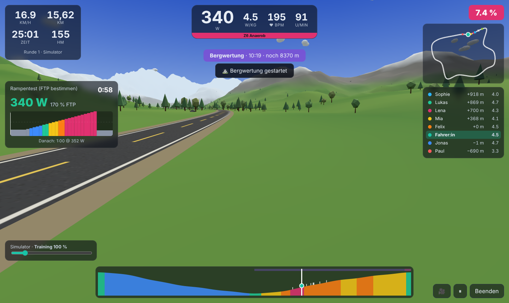
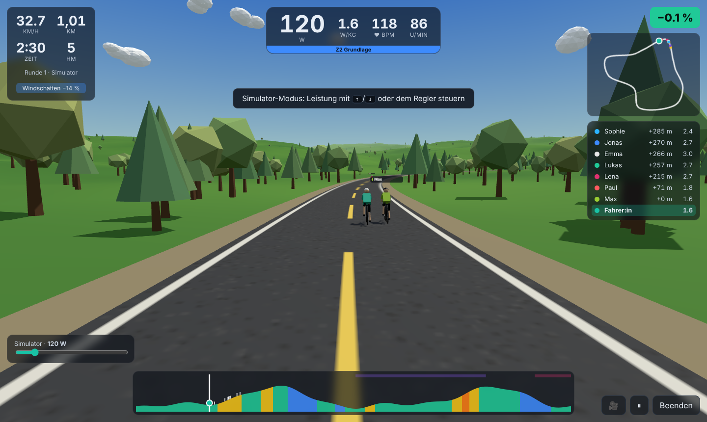
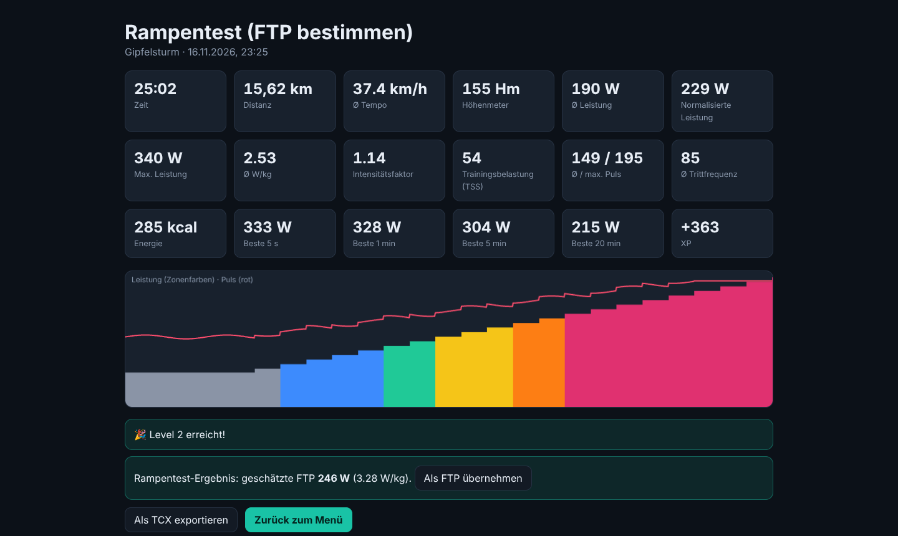

# Radeln – virtuelles Indoor-Radtraining

Radeln ist eine Web-App für das Training auf der Rolle. Du verbindest deinen Smart-Trainer per Bluetooth
und fährst durch prozedural erzeugte 3D-Landschaften, allein oder mit Computer-Fahrern. Dazu gibt es
strukturierte Trainings, Bergwertungen und eine Auswertung nach jeder Fahrt.

## Funktionen

| Bereich | Was es kann |
|---|---|
| **Smart-Trainer** | Bluetooth-Kopplung über offene Standards (FTMS, Cycling Power, Heart Rate). Im **Simulationsmodus** stellt der Trainer die Steigung der Strecke nach, im **ERG-Modus** gibt er die Zielleistung des Trainings vor. |
| **Virtuelles Schalten** | 24 virtuelle Gänge für jeden steuerbaren FTMS-Trainer, auch mit nur einem Ritzel (z. B. Zwift Cog). Schalten per Taste, Bildschirm-Button oder Zwift Click über BikeControl. |
| **Steigungsgefühl** | Regler von 0 bis 100 %, mit dem sich die Steigungssimulation abschwächen lässt |
| **Simulator** | Ohne Gerät steuerst du die Leistung mit den Pfeiltasten oder dem Regler, praktisch zum Ausprobieren |
| **Physik** | Geschwindigkeit aus Leistung, Gewicht, Luft- und Rollwiderstand sowie Steigung, inklusive **Windschatten** (bis −32 %) |
| **Strecken** | 4 eigene Rundkurse: Seeufer-Runde (flach), Hügelland-Schleife (wellig), Gipfelsturm (Pass, über 500 Hm), Waldkriterium (kurz) |
| **Mitfahrer** | Bis zu 24 Computer-Fahrer mit eigenem Leistungsniveau. Etwa die Hälfte fährt in deiner Gruppe mit. |
| **Trainings** | 6 Vorlagen (Grundlage, Sweetspot, Schwelle, VO2max, Sprint-Pyramide, Rampentest), dazu ein Baukasten mit Kurzschreibweise und Import von `.zwo`- und `.json`-Dateien |
| **FTP-Test** | Rampentest mit automatischer FTP-Schätzung, die sich mit einem Klick ins Profil übernehmen lässt |
| **Wertungen** | Bergwertung und Zielsprint mit Zeitnahme und persönlichen Bestzeiten |
| **HUD** | Leistung, W/kg, Puls, Trittfrequenz, Leistungszone, Steigung, Minikarte, Höhenprofil, Fahrerliste mit Abständen |
| **Kameras** | Verfolger, Helm, Seite, Vogel (Taste `C`) |
| **Auswertung** | Ø/NP/Max-Leistung, IF, TSS, Bestwerte (5 s/1/5/20 min), Puls, kcal, Diagramm, XP und Level |
| **Export** | TCX-Datei mit Leistung, Puls, Trittfrequenz und Höhe zum Hochladen auf gängige Trainingsplattformen |

## Starten

```bash
npm install
npm run dev        # Entwicklungsserver auf http://localhost:5173
npm run build      # statischer Build in dist/ (auf jedem Webserver lauffähig)
npm test           # Unit-Tests (Physik, Bluetooth-Parser, Trainings, Statistik, Strecken)
```

**Browser:** Für Bluetooth brauchst du **Chrome oder Edge** auf Desktop oder Android. Firefox und Safari
unterstützen Web Bluetooth nicht, der Simulator-Modus läuft aber auch dort. Web Bluetooth funktioniert
nur über `https://` oder `localhost`.

### Tastatur

| Taste | Funktion |
|---|---|
| `↑` / `↓` | Leistung ±10 W (Simulator, mit Shift ±50 W) bzw. Trainingsintensität ±1 % |
| `←` / `→` | Spur wechseln (für den Windschatten) |
| `+` / `−` (auch `]` / `[`, Bild↑/Bild↓) | Schwerer / leichter schalten |
| `D` | Diagnose-Panel (Trainerwerte, gesendete Befehle) |
| `C` | Kamera wechseln |
| `P` / Leertaste | Pause |
| `H` | HUD reduzieren |

### Trainings-Kurzschreibweise

```
10m 50-75%, 4x(4m 105%, 2m 55%), 8m 60-45%, 5m frei
```
`10m 65%` steht für einen konstanten Block, `5m 50-80%` für eine Rampe, `3x(...)` für Wiederholungen und
`frei` für einen Block ohne Vorgabe. Als Einheiten gehen `s`, `m` und `h`. Prozentwerte beziehen sich auf deine FTP.

## iPad und iPhone

Safari (und jeder andere Browser auf iPadOS/iOS) unterstützt kein Web Bluetooth. Radeln läuft dort deshalb
in der kostenlosen App **[Bluefy – Web BLE Browser](https://apps.apple.com/app/id1492822055)**, die Web Bluetooth nachrüstet.

1. Radeln im Internet veröffentlichen (siehe unten). Bluetooth funktioniert nur über `https://`, eine Adresse im Heimnetz wie `http://192.168…` reicht nicht.
2. Auf dem iPad Bluefy installieren, die Adresse öffnen und den Trainer unter **Geräte** koppeln.
3. Öffnest du die Seite stattdessen in Safari, zeigt Radeln einen Hinweis mit der Adresse zum Kopieren.

Für Tablets gibt es:
- Touch-Bedienung mit großen Buttons:
  - `+`/`−` zum Schalten, im ERG-Training für die Intensität und im Simulator für die Leistung
  - Spurwechsel, Kamera, Diagnose, Vollbild und Pause
- ein Layout für Hoch- und Querformat, das die sicheren Bildschirmränder berücksichtigt
- Display bleibt während der Fahrt an (Screen Wake Lock)
- App-Icon für den Home-Bildschirm

**Einschränkungen:**
- Ob Bluefy mit jedem Trainer zuverlässig verbindet, muss sich im Test zeigen.
- Der Zwift Click über BikeControl funktioniert auf dem iPad sehr wahrscheinlich nicht, weil iOS Apps keine Tastendrücke an andere Apps senden lässt. Am iPad schaltest du über die Bildschirm-Buttons oder eine Bluetooth-Tastatur.
- Eine echte iPad-App (Capacitor) ließe sich später auch ohne eigenen Mac bauen, über einen macOS-Build-Dienst (z. B. GitHub Actions). Dafür ist aber das Apple-Entwicklerprogramm (99 €/Jahr) nötig.

### Veröffentlichen mit GitHub Pages

Der Workflow `.github/workflows/pages.yml` testet, baut und veröffentlicht die App bei jedem Push auf `main`.

1. Auf GitHub unter **Settings → Pages → Build and deployment → Source** den Eintrag **GitHub Actions** wählen.
2. Den Entwicklungszweig in `main` mergen (oder den Workflow unter **Actions** manuell starten).
3. Die App ist dann unter `https://<benutzername>.github.io/<repo>/` erreichbar.

Bei privaten Repositories setzt GitHub Pages einen kostenpflichtigen GitHub-Plan voraus. Außerdem ist die Seite öffentlich erreichbar, auch wenn das Repository privat ist. Alternativ lässt sich der Ordner `dist/` (`npm run build`) bei jedem anderen https-Hoster ablegen, z. B. Netlify oder Cloudflare Pages.

## Virtuelles Schalten

Der Trainer kennt nur seine feste Übersetzung (z. B. Kettenblatt / Cog). Radeln rechnet aus Trittfrequenz
und gewähltem virtuellem Gang das virtuelle Tempo aus und schickt dem Trainer über FTMS eine
**Ersatzsteigung**. Damit musst du genau die Leistung treten, die du in diesem Gang auf der Straße
bräuchtest. Die physische Übersetzung lernt die App aus Trittfrequenz und dem vom Trainer gemeldeten Tempo.

- Funktioniert nur im **Simulationsmodus** (Freie Fahrt bzw. freie Blöcke). Im ERG-Modus gibt der Trainer die Leistung vor, dort ist Schalten pausiert.
- Ein- und ausschalten lässt es sich im Menü unter **Geräte → Virtuelles Schalten**. Der zuletzt gefahrene Gang wird gespeichert.
- Die Steuerung ist unabhängig von Zwift-Protokollen, sie nutzt nur den offenen FTMS-Standard.

### Zwift Click (oder andere Controller) verwenden

Der Click spricht ein nicht veröffentlichtes Protokoll. Am einfachsten verbindest du ihn über die
Open-Source-App [BikeControl](https://github.com/jonasbark/swiftcontrol) und legst die Tasten so:

| Click-Taste | Taste in Radeln |
|---|---|
| Plus (schwerer) | `+` oder `]` |
| Minus (leichter) | `-` oder `[` |

Radeln muss dabei das aktive Fenster sein.

### Checkliste für den ersten Test mit echtem Gerät

1. In Chrome oder Edge `npm run dev` starten und http://localhost:5173 öffnen.
2. Unter **Geräte** den Trainer koppeln. Der Status sollte „FTMS, steuerbar“ anzeigen.
3. Freie Fahrt auf der **Seeufer-Runde** starten und mit `D` das Diagnose-Panel öffnen.
4. Prüfen:
   - Werden *Trainer-Tempo* und *Trittfrequenz* angezeigt?
   - Steht *Phys. Übersetzung* nach etwa 10 s auf „gelernt“, mit einem plausiblen Wert (z. B. 50/14 ≈ 3,57)?
   - Ändern sich *Gesendete Steigung* und spürbar der Widerstand beim Schalten mit `+` und `−`?
   - Steigt die Leistung bei gleicher Trittfrequenz im schwereren Gang?
5. Falls sich das Schalten zu schwach oder zu stark anfühlt, mit dem **Steigungsgefühl** gegensteuern und mir die Werte aus dem Diagnose-Panel schicken. Trainer rechnen intern teils mit einem anderen Fahrergewicht, das muss eventuell nachkalibriert werden.

## Projektstruktur

```
src/
  main.js       Menü, Ablaufsteuerung, Zusammenfassung
  ride.js       Spielschleife: Physik, Mitfahrer, Trainersteuerung, Aufzeichnung, Kamera
  world.js      3D-Welt (Three.js): Gelände, Straße, Vegetation, Landmarken
  riders.js     Low-Poly-Fahrermodell mit Tretanimation
  route.js      Prozedurale Rundkurse und Höhenprofile
  physics.js    Fahrphysik und Windschatten
  shifting.js   Virtuelles Schalten (Gänge, Ersatzsteigung)
  ble.js        Web-Bluetooth: FTMS / Cycling Power / Herzfrequenz
  workouts.js   Trainingsvorlagen, Import, Kurzschreibweise
  stats.js      NP, IF, TSS, Bestwerte, XP/Level
  export.js     TCX-Export
  hud.js        Anzeige während der Fahrt
  storage.js    Lokale Speicherung (localStorage)
test/           Unit-Tests (node:test)
```

## Abgrenzung zu bestehenden Produkten

Radeln ist eine **Eigenentwicklung**. Es nutzt die gleichen allgemeinen Konzepte wie andere
Indoor-Cycling-Apps, übernimmt aber nichts Geschütztes:

- **Eigener Code:** Alles ist neu geschrieben. Es wurde kein fremder Code, keine fremde Grafik, kein Sound und kein Text verwendet.
- **Eigene Welten:** Alle Strecken werden aus Zufallszahlen erzeugt. Es gibt keine nachgebauten Fantasiewelten, Inseln oder Landmarken anderer Apps.
- **Eigenes Erscheinungsbild:** Name, Logo, Farbschema (Türkis/Violett), HUD-Layout, Fahrermodell und Begriffe („Steigungsgefühl“, „Bergwertung“) sind eigenständig.
- **Keine geschützten Spielelemente:** Es gibt keine Power-ups, keine Spielwährung und keine Figuren oder Ausrüstung, die anderen Apps nachempfunden sind.
- **Offene Standards:** Bluetooth FTMS, CPS und HRS sind öffentliche Spezifikationen der Bluetooth SIG. TCX ist ein offenes Austauschformat.
- **Dateiimport:** Der `.zwo`-Import dient nur der Interoperabilität mit Trainingsdateien, die der Nutzer selbst besitzt. Es werden keine fremden Trainingsbibliotheken mitgeliefert.

Allgemeine Spielideen wie „virtuell auf der Rolle fahren“, Windschatten, Intervalltraining oder ein FTP-Test
sind nicht urheberrechtlich geschützt. Geschützt sind konkrete Umsetzungen wie Code, Grafiken, Karten und
Texte sowie Marken. Bei einer Veröffentlichung oder kommerziellen Nutzung solltest du trotzdem
Folgendes beachten:

- Fremde Markennamen nicht für Werbung oder im Produktnamen verwenden (z. B. nicht „wie X“ oder „X-Alternative“ im Namen).
- Vor einem kommerziellen Start eine **Markenrecherche** für „Radeln“ durchführen (DPMA/EUIPO) und rechtlichen Rat einholen. Diese Hinweise ersetzen keine Rechtsberatung.

## Mögliche nächste Schritte

- **Echter Mehrspielermodus** mit einem WebSocket-Server, damit echte Menschen gemeinsam fahren können (aktuell sind die Mitfahrer computergesteuert)
- FIT-Export und direkter Upload zu Trainingsplattformen über deren offizielle APIs
- Weitere Strecken, Tageszeiten und Wetter
- Gruppenfahrten und Rennen mit Startaufstellung
- Mobile App über einen Wrapper (z. B. Capacitor) für iOS, wo Web Bluetooth fehlt

## Screenshots




